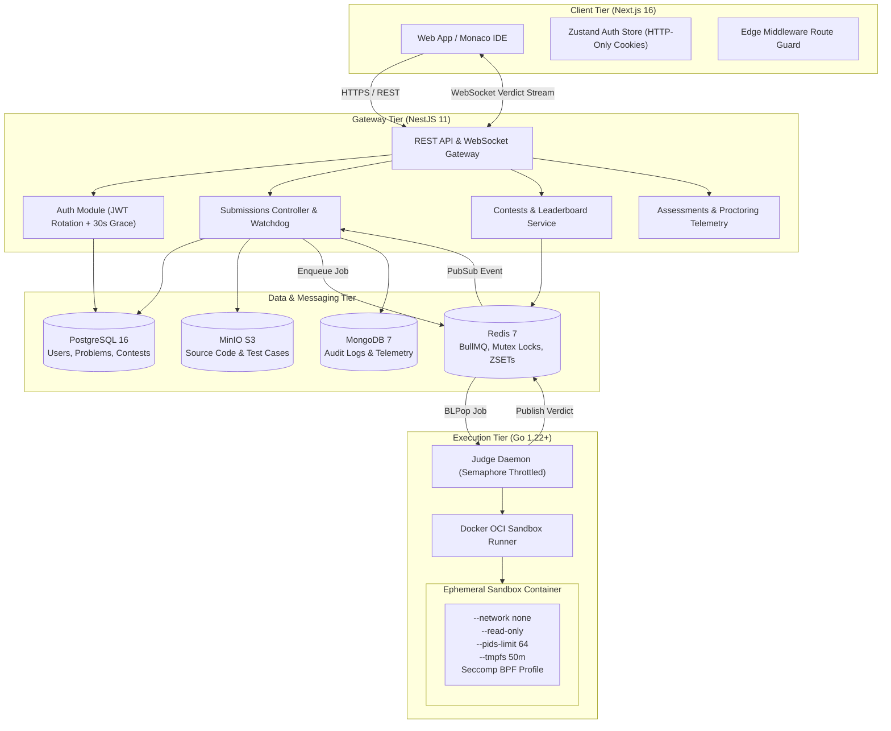

<div align="center">

# TsuniForge

### Distributed Online Judge, Real-Time Contest Engine & Proctored Technical Assessment Platform

[](https://nextjs.org/)
[](https://react.dev/)
[](https://nestjs.com/)
[](https://go.dev/)
[](https://www.typescriptlang.org/)
[](https://www.postgresql.org/)
[](https://redis.io/)
[](https://www.docker.com/)
[](https://github.com/ANSUJKMEHER/TsuniForge/actions/workflows/ci.yml)
[](LICENSE)

<br/>

TsuniForge is an enterprise-grade, distributed competitive programming and technical hiring platform built to grade arbitrary, untrusted user code safely at scale. It combines a Next.js 16 frontend with an embedded Monaco code editor, a high-throughput NestJS API gateway, and a Go execution daemon that evaluates submissions in ephemeral, hardened Docker containers.

[Key Features](#key-features) • [Architecture](#architecture) • [How It Works](#how-it-works) • [Technology Stack](#technology-stack) • [Getting Started](#getting-started) • [API Documentation](#api-documentation) • [Testing](#testing--verification)

</div>

---

## Overview

Competitive programming platforms and remote hiring systems face a fundamental systems engineering challenge: **how to compile and run arbitrary untrusted source code submitted by anonymous users, protect the host operating system from malicious exploits, enforce millisecond-precise execution constraints, and calculate atomic contest standings under heavy concurrent load.**

TsuniForge addresses these requirements with an event-driven monorepo architecture:

- **Isolated Code Grading**: Untrusted user code (C++, Java, Python) runs inside ephemeral Linux containers configured with zero network egress, immutable root filesystems, PID constraints, cgroup memory caps, and custom seccomp filters.
- **Asynchronous Execution Pipeline**: The API gateway accepts submissions, writes source payloads to MinIO S3 storage, and delegates execution to a Redis-backed queue. Go judge workers pre-allocate execution semaphores before pulling jobs, eliminating in-memory job loss.
- **Real-Time ICPC Tournament Engine**: Contest standings update dynamically via Redis Sorted Sets and distributed mutex locks (`SET NX PX` with Lua release scripts), guaranteeing atomic ranking without race conditions.
- **Enterprise Hiring Assessments**: Recruiters can create custom assessment links with live proctoring telemetry that logs browser blur events, tab switches, copy/paste infractions, and fullscreen exits.
- **Problem Studio**: Administrators can create and publish problems with dual-tab markdown editing, difficulty presets, and dynamic test case configurations.

---

## Key Features

### Sandboxed Code Execution

- **Multi-Language Support**: Compiles and executes C++ 17 (GCC 13), Java 17 (OpenJDK), and Python 3.11 with language-specific memory baselines and file capitalization handling (`Solution.java`).
- **Kernel-Level Isolation**: Sandboxes enforce `--network none`, `--read-only` root filesystems, 50MB no-exec tmpfs scratch disks, `--pids-limit 64` (fork-bomb mitigation), and `--memory-swap` set equal to the memory ceiling.
- **Injection-Free I/O**: Test inputs stream directly into container `stdin` without intermediate shell wrapping (`sh -c`), preventing command injection.
- **Exit Code Classification**: Harvests process signals and exit codes directly. Exit code 137 and OOM kernel messages are classified deterministically as `MLE` (Memory Limit Exceeded), while process timeouts trigger automated container termination (`docker rm -f`) resulting in `TLE`.

### High-Concurrency Backend & Contest Engine

- **Atomic ICPC Scoring**: Uses composite Redis Sorted Set scores ($Z = \text{Score} \times 10^9 - \text{PenaltyMs}$) with a 20-minute wrong-attempt penalty (excluding Compile Errors) and chronological submission reordering to handle out-of-order evaluations.
- **Watchdog Queue Reconciler**: Background watchdog sweeps pending database records every 30 seconds, automatically transitioning stalled evaluations into `System Error` (`SE`) to prevent permanently frozen submissions.
- **Robust JWT Rotation**: Access tokens rotate alongside refresh tokens backed by a 30-second concurrency grace window, preventing token invalidation when parallel client requests trigger simultaneous refresh cycles.
- **Granular RBAC & BOLA Guards**: Enforces role-based authorization (`admin`, `company`, `user`) alongside strict Broken Object-Level Authorization (BOLA) ownership validation on candidate sessions, submissions, and assessments.

### Developer Experience & Client Interface

- **Monaco Code IDE**: Complete editor experience with syntax highlighting, custom themes, language-specific code caching, and stdin execution consoles.
- **Live WebSocket Verdicts**: Results stream over private, room-scoped Socket.IO channels (`submission:<id>`), eliminating global broadcast overhead.
- **Proctored Assessment Suite**: Full-screen candidate testing environment with automated event listeners tracking window defocus, tab changes, and clipboard actions.
- **Pre-Seeded 1-Click Authentication**: Interactive login modal with instant pre-seeded demo personas (Admin, Coder, Enterprise Recruiter) for rapid local evaluation.

---

## Visual Presentation

Below is an overview of the primary application surfaces available in TsuniForge:

| Interface                       | Route                                      | Primary Capabilities                                                                                                                       |
| ------------------------------- | ------------------------------------------ | ------------------------------------------------------------------------------------------------------------------------------------------ |
| **Problem Workspace**           | `/problems/[slug]`                         | Split-pane layout with markdown problem spec, Monaco IDE, language selector, stdin custom test case runner, and live execution console.    |
| **ICPC Contest Arena**          | `/contests` & `/contests/[id]/leaderboard` | Live tournament lobby with active/upcoming filters, real-time leaderboard table, penalty calculations, and problem submission statuses.    |
| **Admin Problem Studio**        | `/admin/problems/new`                      | Full problem authoring suite with auto-slug generation, tag selector, time/memory limits, markdown preview, and dynamic test case manager. |
| **Enterprise Recruiter Portal** | `/company/dashboard`                       | Candidate assessment stream, candidate invitation workflow, score metrics, and live anti-cheat proctoring event logs.                      |
| **Multi-Language Playground**   | `/playground`                              | Freeform code execution sandbox supporting C++, Java, and Python with custom input streams and execution timers.                           |
| **Global Leaderboard**          | `/leaderboard`                             | Top-3 podium showcase, global rating tiers, user ranking statistics, and direct profile navigation.                                        |

> **Note for Contributors & Reviewers**: To capture updated UI screenshots for offline documentation, start the development servers locally (see [Getting Started](#getting-started)), navigate to the routes listed above, and place PNG exports in `docs/screenshots/`.

---

## Technology Stack

```
Frontend               Backend                Execution Engine       Data & Infrastructure
─────────────────      ─────────────────      ─────────────────      ─────────────────────
Next.js 16.2.7         NestJS 11.0.0          Go 1.22+               PostgreSQL 16
React 19.2.4           TypeORM 0.3.20         Docker Engine / OCI    Redis 7 (Alpine)
Tailwind CSS 4         BullMQ / Redis         cgroups v2             MinIO S3 Storage
Monaco Editor 4.7      Socket.IO 4.8          Custom Seccomp BPF     MongoDB 7
Zustand 5.0            Passport JWT & Bcrypt                         Turborepo 2.9
TanStack Query 5       Google Generative AI                          GitHub Actions CI
```

### Stack Breakdown

| Layer             | Technology           | Version   | Purpose in TsuniForge                                                                         |
| ----------------- | -------------------- | --------- | --------------------------------------------------------------------------------------------- |
| **Client**        | Next.js (App Router) | 16.2.7    | Server/client component rendering, Edge route protection middleware, static page generation   |
| **UI Library**    | React                | 19.2.4    | Modern hooks architecture, concurrent rendering, error boundaries                             |
| **Styling**       | Tailwind CSS         | 4.0       | Dark OLED design system, glassmorphism utilities, responsive layouts                          |
| **Code Editor**   | Monaco Editor        | 4.7.0     | VS Code browser editor integration with language syntax and indentation configs               |
| **Client State**  | Zustand              | 5.0.0     | Lightweight authentication store with HTTP-only cookie persistence                            |
| **Data Fetching** | TanStack Query       | 5.75.0    | Server-state synchronization, optimistic updates, query caching                               |
| **API Gateway**   | NestJS               | 11.0.0    | Modular TypeScript REST controllers, WebSocket gateways, dependency injection                 |
| **ORM**           | TypeORM              | 0.3.20    | PostgreSQL data modeling, migrations, multi-table transaction boundaries                      |
| **Judge Daemon**  | Go                   | 1.22+     | Multi-threaded worker pool, semaphore scheduling, low-overhead container lifecycle management |
| **Sandboxing**    | Docker Engine        | 24+       | OCI unprivileged container execution, namespace isolation, resource constraints               |
| **Relational DB** | PostgreSQL           | 16-alpine | Primary relational store for users, problems, test cases, contests, and assessments           |
| **Cache & Queue** | Redis                | 7-alpine  | BullMQ job queue, atomic ICPC sorted sets, distributed mutex locks                            |
| **Object Store**  | MinIO                | Latest    | S3-compatible storage for user source code snapshots and high-volume test cases               |
| **Audit Logs**    | MongoDB              | 7.0       | Execution telemetry, proctoring security logs, and AI review event persistence                |
| **Monorepo**      | Turborepo            | 2.9.16    | Monorepo task orchestration, caching pipeline, parallel build coordination                    |

---

## Architecture

TsuniForge is structured as a decoupled microservices monorepo. The web client interacts with the NestJS gateway over HTTPS and authenticated WebSockets, while the Go judge daemon consumes grading tasks asynchronously through Redis.



### Architectural Decisions & Trade-offs

1. **Go for the Judge Engine**: Evaluating code requires sub-millisecond process orchestration and minimal memory overhead. Go provides native goroutine concurrency, efficient memory usage, direct system call interfaces, and low runtime overhead compared to Node.js or Python.
2. **Redis BullMQ over Raw Pub/Sub**: Raw pub/sub drops messages if workers are temporarily saturated. BullMQ backed by Redis provides durable queue persistence, job deduplication, and atomic job lifecycle tracking.
3. **MinIO S3 for Source Snapshots**: Keeping large source code blobs and multi-megabyte test case inputs out of the relational database prevents PostgreSQL table bloat, keeping query latency consistent.
4. **Direct Stdin Streaming vs. Script Wrappers**: Code is executed by invoking compilers and binaries directly (`docker run ... binary`), streaming test case data through stdin pipes. This eliminates shell interpolation vulnerabilities (`sh -c`) entirely.

---

## How It Works

### 1. Sandboxed Submission Lifecycle

```
[User Submits Code]
       │
       ▼ (1. Next.js Client)
Dispatches POST /api/v1/submissions with Bearer JWT and problem UUID.
       │
       ▼ (2. NestJS API Gateway)
Validates payload via class-validator, persists a PENDING record in PostgreSQL,
uploads source code to MinIO, and enqueues a SubmissionJob in Redis.
       │
       ▼ (3. Go Judge Daemon)
Pre-acquires an execution semaphore slot (guaranteeing worker availability),
pops the job via BLPop, and writes source code to a host bind volume (/tmp/tsuniforge/<id>).
       │
       ▼ (4. Ephemeral Docker Sandbox)
Runs isolated compilation and execution:
  ├── --network none          (Zero socket / internet connectivity)
  ├── --read-only             (Root filesystem is strictly immutable)
  ├── --tmpfs /scratch        (50MB in-memory scratch space)
  ├── --pids-limit 64         (Blocks process forking and thread-bomb attacks)
  ├── --memory-swap = limit   (Completely disables swap usage)
  └── --security-opt seccomp  (Blocks kernel probing, ptrace, and raw sockets)
Test case inputs stream into stdin; stdout/stderr are captured in memory buffers.
       │
       ▼ (5. Exit & Resource Evaluation)
Verifies output equality against expected results. Exit code 137 -> MLE.
Wall-clock timeouts trigger immediate forced container removal (docker rm -f) -> TLE.
       │
       ▼ (6. Verdict Publishing & WebSockets)
Result is published to Redis channel `submission_results`.
The API gateway consumes the event, updates PostgreSQL, and emits
the verdict strictly to the user's private WebSocket room (`submission:<id>`).
```

### 2. Atomic ICPC Contest Scoring Algorithm

To support high-concurrency contest rushes without race conditions, leaderboard calculations use atomic Redis operations:

$$\text{Composite Score} = (\text{Problems Solved} \times 10^9) - \text{Total Penalty Milliseconds}$$

- **Penalties**: Each accepted problem adds $\text{Solve Time} + (\text{Wrong Attempts} \times 20 \times 60 \times 1000\text{ ms})$.
- **Exemptions**: Compile Errors (`CE`) do not count as wrong attempts.
- **Out-of-Order Handling**: In case judge workers evaluate submissions out of order, the leaderboard engine deterministically sorts all submission events chronologically before computing total penalty and problem verdicts.
- **Distributed Locking**: Updates acquire a Redis lock (`lock:contest:<id>:user:<id>`) via `SET NX PX` with a 5-second TTL, released using an atomic Lua script.

### 3. JWT Token Rotation with Concurrency Grace Window

To avoid race conditions where multiple parallel client requests trigger refresh requests simultaneously:

1. When a refresh token is exchanged, a new pair is issued, and the previous token hash is stored with a `tokenRotatedAt` timestamp.
2. If another concurrent request presents the previous refresh token within **30 seconds**, the server returns the existing valid token pair instead of revoking the session.
3. If an expired or previous token is presented **outside** the 30-second window, the system detects a token reuse attack and immediately invalidates all active sessions for that user account.

---

## Getting Started

### Prerequisites

Ensure the following tools are installed on your machine:

- **Node.js**: `>= 20.x`
- **npm**: `>= 10.x`
- **Docker & Docker Compose**: `>= 24.x` (Docker daemon must be running)
- **Go**: `>= 1.22` (required only if running the judge worker outside Docker)

---

### Step-by-Step Installation

#### 1. Clone Repository & Install Dependencies

```bash
git clone https://github.com/ANSUJKMEHER/TsuniForge.git
cd TsuniForge

# Install all monorepo dependencies via Turborepo
npm install
```

#### 2. Start Infrastructure Services

Spin up PostgreSQL, Redis, MongoDB, and MinIO in the background:

```bash
# Launch core databases and object storage
docker-compose up -d

# (Optional) Launch database management GUIs (Adminer & Redis Commander)
docker-compose --profile dev-tools up -d
```

Verify services are healthy:

```bash
docker ps --format "table {{.Names}}\t{{.Status}}\t{{.Ports}}"
```

#### 3. Configure Environment Variables

Default environment configuration templates are provided for both API and frontend:

```bash
# API Gateway environment
cp apps/api/.env.example apps/api/.env

# Web Frontend environment
cp apps/frontend/.env.example apps/frontend/.env
```

_Key environment defaults used for local development:_

| Parameter                       | Default Value                      | Description                               |
| ------------------------------- | ---------------------------------- | ----------------------------------------- |
| `DB_HOST` / `DB_PORT`           | `localhost` / `5432`               | PostgreSQL relational database connection |
| `DB_USERNAME` / `DB_PASSWORD`   | `tsuniforge` / `tsuniforge_secret` | PostgreSQL credentials                    |
| `REDIS_HOST` / `REDIS_PORT`     | `localhost` / `6379`               | Redis cache and queue connection          |
| `JWT_SECRET`                    | `tsuniforge_jwt_secret_dev_key`    | Secret used to sign access tokens         |
| `JWT_REFRESH_SECRET`            | `tsuniforge_refresh_secret_dev`    | Secret used to sign refresh tokens        |
| `MINIO_ENDPOINT` / `MINIO_PORT` | `localhost` / `9000`               | S3-compatible MinIO object store          |
| `NEXT_PUBLIC_API_URL`           | `http://localhost:4000`            | Frontend-facing API gateway address       |

#### 4. Build Sandbox Docker Images

The Go judge engine executes submissions inside dedicated language containers. Build these images locally:

```bash
cd apps/judge
docker build -t tsuniforge-sandbox-cpp -f docker/Dockerfile.cpp .
docker build -t tsuniforge-sandbox-java -f docker/Dockerfile.java .
docker build -t tsuniforge-sandbox-python -f docker/Dockerfile.python .
cd ../..
```

#### 5. Seed Database with Problems & Personas

Populate the database with pre-configured algorithmic problems (Two Sum, Reverse String, etc.) and demo accounts:

```bash
npm run db:seed
```

#### 6. Start Development Servers

Run the applications using Turborepo or start each service independently:

```bash
# Option A: Start API and Frontend concurrently
npm run dev

# Option B: Run services in separate terminals
npm run dev:api    # Starts NestJS on http://localhost:4000
npm run dev:web    # Starts Next.js on http://localhost:3000

# Start the Go Judge Engine (separate terminal):
cd apps/judge
go run cmd/judge/main.go
```

---

## Service Endpoints & Management

Once running, access the platform and supporting developer tools at:

| Service              | Port / URL                                                         | Description                   | Default Credentials                    |
| -------------------- | ------------------------------------------------------------------ | ----------------------------- | -------------------------------------- |
| **Web Application**  | [`http://localhost:3000`](http://localhost:3000)                   | Next.js 16 Web Client         | _See Demo Credentials below_           |
| **REST API Gateway** | [`http://localhost:4000`](http://localhost:4000)                   | NestJS Core Backend           | —                                      |
| **Swagger API Docs** | [`http://localhost:4000/api/docs`](http://localhost:4000/api/docs) | Interactive OpenAPI Explorer  | —                                      |
| **WebSocket Stream** | `ws://localhost:4000/ws`                                           | Real-time verdicts & rankings | Bearer JWT required                    |
| **MinIO Console**    | [`http://localhost:9001`](http://localhost:9001)                   | S3 Object Storage Browser     | `tsuniforge` / `tsuniforge_secret`     |
| **Adminer**          | [`http://localhost:8080`](http://localhost:8080)                   | PostgreSQL Management GUI     | System: PostgreSQL, Server: `postgres` |
| **Redis Commander**  | [`http://localhost:8081`](http://localhost:8081)                   | Redis Queue & Key Inspector   | —                                      |

### Pre-Seeded Demo Credentials

The login page at [`http://localhost:3000/login`](http://localhost:3000/login) includes **1-click demo buttons** to log into any of these pre-seeded roles:

| Role                    | Email                    | Password      | Access Scope                                                 |
| ----------------------- | ------------------------ | ------------- | ------------------------------------------------------------ |
| **Administrator**       | `admin@tsuniforge.com`   | `Admin123!`   | Problem authoring studio, unpublishing, full submission view |
| **Contestant / User**   | `user@tsuniforge.com`    | `User123!`    | Code submissions, contest participation, global rankings     |
| **Recruiter / Company** | `company@tsuniforge.com` | `Company123!` | Technical assessments, candidate management, proctoring logs |

---

## Project Structure

```
TsuniForge/
├── apps/
│   ├── frontend/                       # Next.js 16 App Router Frontend
│   │   ├── src/
│   │   │   ├── app/                    # Application routes
│   │   │   │   ├── (auth)/             # Login & registration pages
│   │   │   │   ├── admin/              # Problem authoring studio & inventory
│   │   │   │   ├── assessment/         # Candidate proctored assessment suite
│   │   │   │   ├── company/            # Recruiter evaluation & telemetry dashboard
│   │   │   │   ├── contests/           # Tournament hub & live contest leaderboards
│   │   │   │   ├── leaderboard/        # Global user standing & rating tiers
│   │   │   │   ├── playground/         # Freeform multi-language scratchpad
│   │   │   │   ├── problems/           # Catalog & split-pane Monaco problem solver
│   │   │   │   └── not-found.tsx       # Branded custom 404 page
│   │   │   ├── lib/                    # Axios API client with 401 token refresh interceptor
│   │   │   ├── stores/                 # Zustand stores (session & authentication)
│   │   │   └── middleware.ts           # Next.js Edge route guard for protected paths
│   │   ├── next.config.ts              # Strict Content Security Policy & HTTP security headers
│   │   └── eslint.config.mjs           # ESLint 9 configuration with React 19 rules
│   │
│   ├── api/                            # NestJS 11 Application Gateway
│   │   ├── src/
│   │   │   ├── database/               # TypeORM entities, PostgreSQL migrations & seeders
│   │   │   ├── modules/
│   │   │   │   ├── auth/               # JWT strategy, 30s grace rotation, OAuth, RolesGuard
│   │   │   │   ├── problems/           # Problem CRUD, tags, difficulty, test case relations
│   │   │   │   ├── submissions/        # BullMQ job queue, watchdog reconciler, WebSockets
│   │   │   │   ├── contests/           # Mutex-locked ICPC leaderboard & plagiarism winnowing
│   │   │   │   └── assessments/        # Proctoring telemetry ingestion & candidate invites
│   │   │   ├── common/                 # S3 MinIO client, Gemini AI reviews, MongoDB logger
│   │   │   └── main.ts                 # Bootstrap with validation pipes & CORS configuration
│   │   └── test/                       # Jest unit & adversarial security test suites
│   │
│   └── judge/                          # Go 1.22+ Online Judge Execution Engine
│       ├── cmd/judge/                  # Main entry point with OS signal handling & drain
│       ├── internal/
│       │   ├── config/                 # Environment parsing & container constraint defaults
│       │   ├── executor/               # Ephemeral Docker runner, ID sanitization, OOM/MLE parser
│       │   ├── models/                 # SubmissionJob and JudgeResult data structures
│       │   └── queue/                  # Semaphore-throttled Redis BLPop consumer
│       ├── configs/security/           # Seccomp BPF filter profile (ARM64 & x86_64)
│       └── docker/                     # Sandboxed runtime Dockerfiles (C++, Java, Python)
│
├── deploy/                             # Production Deployment Assets
│   ├── docker-compose.prod.yml         # Hardened production composition
│   ├── setup-server.sh                 # One-shot Ubuntu VM provisioning script
│   └── nginx/                          # Reverse proxy configuration with SSL termination
│
├── packages/
│   └── common/                         # Shared TypeScript interfaces, enums & contracts
│
├── .github/workflows/ci.yml            # GitHub Actions CI matrix (Lint, Build, Go, Jest)
├── docker-compose.yml                  # Local development multi-container composition
├── package.json                        # Root npm workspaces configuration
└── turbo.json                          # Turborepo caching & execution pipeline
```

---

## API Documentation

Below is a reference of key REST endpoints exposed by the NestJS API gateway. Interactive Swagger documentation is available at `http://localhost:4000/api/docs`.

### Authentication & Users

| Method | Endpoint                    | Access     | Description                                               |
| ------ | --------------------------- | ---------- | --------------------------------------------------------- |
| `POST` | `/api/v1/auth/register`     | Public     | Register a new account (`username`, `email`, `password`)  |
| `POST` | `/api/v1/auth/login`        | Public     | Authenticate credentials; returns access & refresh tokens |
| `POST` | `/api/v1/auth/refresh`      | Public     | Exchange refresh token for new session (30s grace window) |
| `POST` | `/api/v1/auth/logout`       | Bearer JWT | Invalidate active refresh token in database               |
| `GET`  | `/api/v1/auth/me`           | Bearer JWT | Fetch authenticated user profile and roles                |
| `GET`  | `/api/v1/users/leaderboard` | Public     | Retrieve global user leaderboard sorted by rating         |

### Problems

| Method   | Endpoint                 | Access | Description                                                            |
| -------- | ------------------------ | ------ | ---------------------------------------------------------------------- |
| `GET`    | `/api/v1/problems`       | Public | List paginated problems with `difficulty`, `tag`, and `search` filters |
| `GET`    | `/api/v1/problems/:slug` | Public | Fetch complete problem spec and sample test cases                      |
| `POST`   | `/api/v1/problems`       | Admin  | Create a new problem with test cases and time/memory limits            |
| `PUT`    | `/api/v1/problems/:id`   | Admin  | Update existing problem metadata, constraints, or test cases           |
| `DELETE` | `/api/v1/problems/:id`   | Admin  | Remove problem and associated test cases                               |

### Submissions & Execution

| Method | Endpoint                  | Access     | Description                                                                |
| ------ | ------------------------- | ---------- | -------------------------------------------------------------------------- |
| `POST` | `/api/v1/submissions`     | Bearer JWT | Submit code for full evaluation. Returns `202 Accepted` with submission ID |
| `POST` | `/api/v1/run`             | Bearer JWT | Execute code against arbitrary custom stdin; returns output immediately    |
| `GET`  | `/api/v1/submissions/:id` | Bearer JWT | Retrieve submission verdict and per-testcase details (BOLA-protected)      |
| `GET`  | `/api/v1/submissions`     | Bearer JWT | List submissions filtered by `problemId`, `userId`, or `status`            |

### Contests

| Method | Endpoint                           | Access     | Description                                            |
| ------ | ---------------------------------- | ---------- | ------------------------------------------------------ |
| `GET`  | `/api/v1/contests`                 | Public     | List contests by status (`active`, `upcoming`, `past`) |
| `GET`  | `/api/v1/contests/:id`             | Public     | Get contest information, rules, and window times       |
| `GET`  | `/api/v1/contests/:id/leaderboard` | Public     | Fetch real-time ICPC contest standings from Redis ZSET |
| `POST` | `/api/v1/contests/:id/register`    | Bearer JWT | Register authenticated user for a tournament           |

### Assessments & Proctoring

| Method | Endpoint                             | Access          | Description                                                         |
| ------ | ------------------------------------ | --------------- | ------------------------------------------------------------------- |
| `POST` | `/api/v1/companies`                  | Admin / Company | Create employer profile and link domain                             |
| `POST` | `/api/v1/assessments`                | Admin / Company | Create timed technical assessment                                   |
| `POST` | `/api/v1/assessments/:id/candidates` | Admin / Company | Issue candidate invitation token                                    |
| `POST` | `/api/v1/assessments/:id/events`     | Candidate JWT   | Record proctoring telemetry (tab blur, copy/paste, fullscreen exit) |
| `POST` | `/api/v1/assessments/:id/submit`     | Candidate JWT   | Finalize and submit assessment responses                            |

---

## Testing & Verification

TsuniForge enforces a rigorous testing strategy across all three application layers:

### 1. Go Judge Engine Unit Tests

The Go test suite validates container security configurations, input validation, and process exit code classifications without requiring a running Docker daemon:

```bash
cd apps/judge
go test ./... -v -count=1
```

_Verified Test Coverage:_

- `internal/config`: Default resource limit loading and environment variable overrides.
- `internal/executor`: Alphanumeric UUID sanitization (`^[a-zA-Z0-9_-]+$`), shell command injection rejection, exit code 137 `MLE` mapping, and compiler container argument construction (`--network none`, `--read-only`, `--pids-limit 64`, tmpfs mounts).
- `internal/models`: JSON serialization and deserialization contracts for `SubmissionJob` and `JudgeResult`.
- `internal/queue`: Semaphore-bounded worker pool initialization and graceful drain upon OS termination signals (`SIGINT`/`SIGTERM`).

### 2. NestJS API Unit & Security Test Suites

The backend test suite verifies core business logic, concurrency guards, and security controls:

```bash
cd apps/api
npm test
```

_Verified Test Coverage (9 Suites, 61/61 Tests Passing):_

- `leaderboard.service.spec.ts`: Redis mutex lock acquisition, out-of-order submission resolution, and ICPC CE penalty exclusion.
- `roles.guard.spec.ts`: Global role enforcement for administrative and employer routes.
- `jwt.strategy.spec.ts`: Active and suspended account verification during token authorization.
- `auth.service.spec.ts`: 30-second token rotation grace window and token reuse breach detection.
- `judge-queue.service.spec.ts`: Asynchronous submission enqueueing and stuck-submission watchdog reconciliation.
- `submissions.controller.spec.ts`: BOLA ownership checks preventing unauthorized submission inspection.
- `assessments.service.spec.ts`: Proctoring telemetry recording and exam deadline expiration assertions.

### 3. Frontend Production Build & Type Verification

Validates full TypeScript safety, ESLint compliance, and static route generation across the entire Next.js application:

```bash
# Verify TypeScript types across the monorepo
npm run check-types

# Verify ESLint across all packages
npm run lint

# Compile production Next.js build
cd apps/frontend
npm run build
```

_Verified Result: Zero type errors, zero ESLint warnings, and clean generation of all 16 static and dynamic routes._

### 4. Continuous Integration Pipeline

Every push and pull request to the `main` branch triggers the GitHub Actions CI pipeline (`.github/workflows/ci.yml`), which automatically runs:

1. Turborepo monorepo linting (`npm run lint`)
2. TypeScript compilation check (`npm run check-types`)
3. NestJS API test suites against isolated PostgreSQL and Redis service containers
4. Next.js 16 production compilation (`npm run build`)
5. Go judge engine tests (`go test ./...`) and static analysis (`go vet ./...`)

---

## Troubleshooting

### 1. Docker Socket Permission Denied (Judge Engine)

If running the judge engine directly on Linux and encountering `Got permission denied while trying to connect to the Docker daemon socket`:

```bash
sudo usermod -aG docker $USER
newgrp docker
```

### 2. Port Collisions on Startup

If Docker ports (`5432`, `6379`, `9000`) conflict with existing local services:

- Stop local PostgreSQL or Redis daemons: `sudo systemctl stop postgresql redis`
- Or edit port mappings in `docker-compose.yml` (e.g., `"5433:5432"`).

### 3. MinIO Bucket Not Initialized

If the API reports an error accessing the test case bucket on first run, create the default bucket through the MinIO web console at `http://localhost:9001` or via the MinIO CLI:

```bash
# Install MinIO client and create bucket
docker exec -it tsuniforge-minio mc alias set local http://localhost:9000 tsuniforge tsuniforge_secret
docker exec -it tsuniforge-minio mc mb local/tsuniforge-submissions
```

---

## Future Improvements

- [ ] **gVisor (`runsc`) MicroVM Sandboxing**: Transition from standard Docker container isolation to Google's user-space kernel (gVisor) to protect against theoretical kernel exploit escapes.
- [ ] **PostgreSQL Row-Level Security (RLS)**: Enforce multi-tenant data partitioning at the database level for enterprise hiring assessments.
- [ ] **Redis Streams Consumer Groups**: Migrate from Redis lists (`BLPop`) to distributed Redis Stream consumer groups with persistent Dead Letter Queues (DLQ) for multi-region judge auto-scaling.
- [ ] **Direct cgroup v2 Metric Polling**: Read `/sys/fs/cgroup` controllers directly in Go to report microsecond-precise CPU cycle metrics and peak RSS memory attribution.
- [ ] **Distributed Plagiarism Engine**: Offload pairwise winnowing and MinHash Locality-Sensitive Hashing (LSH) scans to background worker queues.

---

## Contributing

Contributions to TsuniForge are welcome. To contribute:

1. Fork the repository and create a feature branch (`git checkout -b feat/feature-name`).
2. Adhere to TypeScript and Go formatting standards (`npm run format`, `go fmt ./...`).
3. Ensure all test suites pass before opening a PR (`npm run check-types`, `npm test`, `cd apps/judge && go test ./...`).
4. Commit your changes using conventional commit messages (`feat: ...`, `fix: ...`).
5. Open a Pull Request against the `main` branch with a clear description of the modifications.

See [`CONTRIBUTING.md`](CONTRIBUTING.md) for full contribution guidelines.

---

## License

This project is licensed under the **[MIT License](LICENSE)**.

```
Copyright (c) 2026 Ansuj Kumar Meher
```

---

<div align="center">

**Developed by [Ansuj Kumar Meher](https://github.com/ANSUJKMEHER)**

_Built for robust, fair, and scalable competitive programming and technical hiring._

</div>
